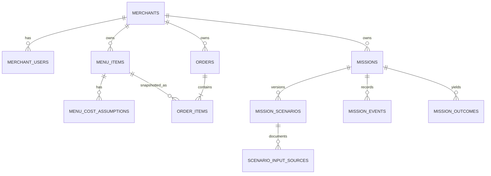

# Database design

PostgreSQL is authoritative. IDs are UUIDs, timestamps are `timestamptz` in UTC, money is `numeric(12,2)`, and rates are `numeric(7,4)`. Business-day boundaries are computed in `Asia/Bangkok` before UTC queries. The seed uses fixed UUIDs and a fixed anchor date. There is no real customer table or personal order data.

`merchant_id` is carried on every owned table and participates in composite foreign keys. This supports repository scoping and prevents accidental cross-merchant joins. `merchant_users` is the prototype membership and authentication subject. A production identity provider would replace only its login mechanism. `menu_cost_assumptions` tracks cost provenance and time instead of overwriting historical inputs. `order_items` snapshots price, discount, deduction, and costs used for every completed line. `mission_scenarios` stores versioned baseline and proposed alternatives; scenario input source rows explain each amount. `mission_events` is the append-only transition log. `mission_outcomes` stores separately labeled simulated baseline and trial arms.

## Relationship and integrity rules

* A merchant has many users, menu items, orders, and missions. Each order has at least one item as a service-level transaction rule (SQL FK alone does not enforce minimum one).
* Each scenario revision has exactly one `baseline` and one `proposed` row. A unique key prevents duplicate arms; a deferred constraint trigger rejects a half-written revision at commit and requires six source records per arm. The service inserts both arms and twelve sources atomically. Mission current/approved revisions must point to complete pairs. Scenario arms are immutable; approved source metadata is immutable after the approval transaction.
* Mission status is persisted for fast reads, but every transition inserts an event in the same transaction. The service validates the exact legal edges; direct database writers are outside the supported application boundary. A transition-enforcing database trigger is a future hardening option if that boundary changes.
* Outcome arms are `baseline` and `trial`, unique per mission and explicitly marked simulated. They exist only after simulated completion. The service verifies the mission is running and both arms are written atomically; the outcome stores a short learning summary and next-step guidance.
* Historical order rows have one `menu_item_id`; proposed bundle is a hypothetical scenario, not a live menu item. No real menu price is changed by approval.

## Indexes and access

Indexes cover merchant-local order dates, item ranking joins, mission status, and events. All reads start from authenticated `merchant_id`; mission and outcome IDs are always checked with that scope. SQL constraints in [database-schema.sql](database-schema.sql) enforce numeric ranges, uniqueness, ownership, and enums. Application services enforce state and aggregate invariants that require multiple rows.

`merchant_confirmed` on menu assumptions, scenario sources, and order snapshots requires a non-null `confirmed_at`; all other provenance kinds require it to be null. Order-line price/cost/discount/deduction amounts are explicit snapshots, including explicit zero values. Scenario costs/rate/discount may be null while incomplete; the service returns an unavailable estimate and blocks approval. Scenario saves lock the mission row and create a new revision. Unchanged previously confirmed values can retain their source record in the new revision; changed values revert to `assumption` until confirmed in the approval transaction. The approval request must carry the reviewed revision and acknowledgments. Under the same row lock, the service stamps confirmation, approved revision, idempotency key, status, and event atomically. Reused keys with different request fingerprints are conflicts.

## Seed plan

Use seed version `westrong-v1`, fixed anchor 2026-11-07. Generate completed fictional orders for six **closed** months, 2026-05-01 through 2026-10-31, plus 2026-11-07 for “today.” Vary day-of-week and month deterministically, with chicken rice the top item, drinks often co-purchased, and several other Thai dishes. Use fixed per-item historical price/cost snapshots. Seed one proposed bundle mission and one separate completed simulated mission with both outcome arms and event sequence. Regeneration in an isolated demo database is idempotent by fixed IDs and seed version; it does not overwrite user-entered demo changes unless an explicit reset is requested. REST and MCP aggregates query the same completed order lines and exclude outcome arms. Reconciliation fixtures compare row sums, dashboard, analytics, and MCP values exactly.
# Additive migration 0002_multi_strategy

`mission_strategy_inputs` stores merchant-scoped, revisioned synthetic seven-day volume, discount, and advertising assumptions while a mission is proposed. `mission_strategy_approvals` stores one immutable JSONB evaluation snapshot, chosen strategy, scenario/evaluation revisions, and model version, inserted atomically with existing approval and idempotency records. Both use the mission's `(merchant_id, mission_id)` relationship. Approved strategy rows reject updates/deletes; previously approved missions without a snapshot retain their legacy behavior. The migration was specified in [multi-strategy-methodology.md](multi-strategy-methodology.md) before execution.
