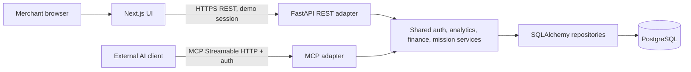

# System architecture

## Decision

A modular monolith serves the Next.js App Router UI and a Python FastAPI backend. The backend contains domain services used by both REST routers and a thin Python MCP adapter. PostgreSQL is the source of truth. For local tests, the same SQLAlchemy models can use a disposable PostgreSQL instance; SQLite is not the contractual database. Supabase is a hosted PostgreSQL option, not a separate business API. No queue, Redis, or microservice is required.

## Boundaries and data flow

* UI owns navigation, inline review editing, expandable detail, and presentation. It never finalizes financial values or changes mission state locally. One review view replaces the former mandatory cost, comparison, and final-review pages.
* FastAPI validates request shape, authenticates, builds merchant context, and maps domain errors to one error envelope. No request accepts a merchant ID as an access override.
* Services own aggregation, Decimal arithmetic, scenario versioning, transitions, and authorization. MCP tools call these exact services, not REST over localhost and not direct SQL.
* Repositories scope every merchant-owned query by authenticated merchant ID. Composite foreign keys prevent cross-merchant references in the schema. Supabase service credentials stay server-side.
* MCP transport and identity are separate from tool logic. Local inspector may use a documented demo bearer token restricted to one synthetic merchant. Remote access requires TLS, short-lived merchant-scoped tokens, audience verification, revocation, and rate limiting. Do not assume ChatGPT account support; verify client capability, with MCP Inspector as fallback.

## Mission lifecycle

`proposed → approved → running → completed → reviewed`; `proposed → rejected`; `approved/running → cancelled`. `approved → running → completed` is driven by an explicit **Run simulated trial** demo action, which creates deterministic synthetic outcome records and separate events in one transaction. No clock-driven background activation is needed. `completed → reviewed` records merchant acknowledgment. Terminal states are immutable. Every transition updates the mission and inserts an event, actor, UTC timestamp, and reason/source in one transaction; invalid edges fail.

Scenario saves and approval both acquire `SELECT ... FOR UPDATE` on the mission row. A save compares `If-Match` with `current_revision`, inserts both immutable arms and all source rows, then increments the revision in one transaction. The approval transaction locks the same row, checks `proposed`, current/reviewed revision equality, complete values, explicit financial confirmation and simulation consent, then stamps source confirmation metadata, stores the idempotency key/approved revision, changes status, and inserts one event. Repeating the same key with the same revision and payload returns the prior approval; another key or stale revision returns 409. The service must compare a stored request fingerprint or equivalent to reject reuse of a key with a different payload. Approved arms and sources cannot be edited. This serialized path prevents a concurrent save from approving stale figures.

## Security and operational assumptions

Local demo: seed a user and issue a fixed, non-production demo session only in local development; protect every REST mutation with session authentication and CSRF protection if cookie-based. Hosted UI uses a conventional authenticated session with secure, HttpOnly, SameSite cookie; backend resolves a single merchant membership. Remote MCP uses a separate read-only scope. Never put database credentials or Supabase service-role keys in browser or client config. Keep request IDs and audit logs without customer PII. Validate date ranges, pagination, money scale, and enum values. Apply per-user/per-token rate limits at the API edge. For hackathon deployment, one web service, one API/MCP service, and managed Postgres are sufficient.

## Trade-offs and risks

The two transports can share services without coupling their client experiences. An explicit simulate action makes the demo reproducible but does not model a real background trial. Cost and fee data are assumptions; the UI must expose provenance. A shorter review trades separate teaching screens for progressive disclosure, so comprehension should be measured in user testing. Hosted remote MCP authentication and external-client compatibility require validation before implementation. See implementation plan for sequencing.
