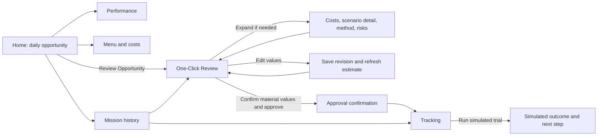

# UX flow and screen architecture — revised Phase 1

Primary canvas: 390 × 844 CSS pixels, responsive down to 320 px. Desktop centers a mobile-width app preview. Minimum touch target 44 × 44 px, visible focus state, accessible contrast, semantic headings, and text labels alongside color. Persistent navigation: **Home, Performance, Menu, Missions**. Keep **Unofficial Concept Prototype — Synthetic Data** visible in the shell; show **Simulated outcome** on outcome content.

## Primary journey

| View | Content and action | Backend data |
|---|---|---|
| Home / Daily Opportunity | Westrong Kitchen, concise sales snapshot, one prominent chicken-rice bundle recommendation, short evidence, “Review Opportunity”. | `GET /merchants/me`, `/dashboard`, mission rationale |
| One-Click Review | Proposed action, current ฿16.30, bundle ฿24.30, +฿8.00 per unit; source labels and trial terms. Expandable **Costs**, **Deduction & discount**, **Scenario detail**, **How calculated**, **Risks**. Inline editing and clear cost confirmation; one prominent “Approve simulated trial” after review. | `GET /missions/{id}`, `GET/PUT /missions/{id}/scenarios`, `POST /missions/{id}/approve` |
| Approval confirmation | Same route as review, success state with approved revision and “Track results”; no extra mandatory decision page. | Approval response, then `GET /missions/{id}` |
| Tracking & outcome | State timeline, baseline, simulated trial, per-unit and total contribution comparison, learning summary, next-step guidance; explicit “Run simulated trial” and optional “Mark reviewed”. | `GET /missions/{id}`, `POST /missions/{id}/simulate`, `GET /missions/{id}/outcome`, `POST /missions/{id}/transitions` |

## Supporting destinations

| View | Purpose | Backend data |
|---|---|---|
| Sales & Performance | 7/30/180-day sales, orders, AOV, menu ranking, contribution versus revenue. | `GET /analytics/sales`, `/analytics/menus` |
| Menu & Costs | Read-only item price/availability, cost status/source, estimated contribution or “Needs cost details”. Editing relevant mission assumptions happens inline in Review. | `GET /menus` |
| Mission history | Proposed, approved, completed, reviewed, rejected, and cancelled missions. | `GET /missions`, `/missions/{id}` |
| Detailed scenario analysis | Optional expansion in Review, not a required page. | `GET /missions/{id}/scenarios` |

The default path needs **Review Opportunity → confirm material inputs and approve → Track results** after opening Home. No separate cost, comparison, or final review page is mandatory. Expansions provide detail without losing context. The approval confirmation is a success state, not an extra gate.

## Confirmation behavior

The review shows each input as **Estimated**, **Synthetic history**, or **Confirmed by merchant**. Missing cost or deduction inputs show “Estimate unavailable” and disable approval until supplied; they are never zero-filled. Previously confirmed values carry forward only when their value and relevant scenario context remain unchanged. Editing a value saves a new revision and refreshes backend math; the edited field becomes unconfirmed until the merchant reconfirms it. The review has an explicit “I confirm the displayed financial inputs” control and a separate simulation acknowledgment. The approval request includes the reviewed revision, both acknowledgments, and an idempotency key. The backend locks the mission, rejects stale revisions, stamps confirmation metadata for required fields, records the approval event, and approves atomically. No real promotion is published.

Loading, empty, and error states: text skeleton on first load; “No orders in this period” and null AOV for empty analytics; inline numeric errors; recoverable retry; conflict message and refreshed figures after a stale edit; clear unauthorized state. Screen reader announcements describe changed status and errors. Use Grab-inspired green (`#0B7A3B` suggested, subject to contrast check), white and soft neutral surfaces, restrained borders, rounded controls, and plain language. Avoid a crowded dashboard and proprietary assets.
# One Click multi-strategy flow (Phase 3 extension)

`Home → recommendation bottom sheet → confirm assumptions and simulation → approve once → mission processing → backend result → Results & Learning → reviewed`.

Within the bottom sheet, three compact strategy rows are visible without horizontal scrolling. Bundle, Discount, or Advertising detail, the comparison list, assumption editing, and cost editing are optional branches that return to the same approval surface. On 320–430 px viewports, sheet content scrolls vertically and consent/actions remain in a fixed footer. Closing the sheet leaves the Home recommendation entry point; opening it again fetches current backend evaluation. There is no second approval screen and no seven-day timer.
